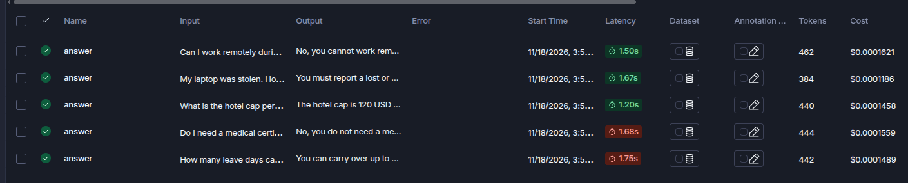

# Tracing the RAG flow

Spec: [../day-09-extraction-evals/SPEC.md](../day-09-extraction-evals/SPEC.md) · Notes: [NOTES.md](NOTES.md)

The Day 8 RAG flow (copied here so Day 8 stays untouched) with LangSmith tracing. `answer(question)` is one trace with three child spans: `embed_query`, `vector_search` and `generate_answer`. Each step also records its own latency, tokens and cost, so the numbers below do not depend on reading a UI. [trace_run.py](trace_run.py) runs the five Day 8 questions once at chunk size 600 and saves [results/run.json](results/run.json).

## How to run

```
python3 -m venv venv && source venv/bin/activate
pip install -r requirements.txt
cp .env.example .env        # Gemini key, DATABASE_URL (the Day 8 day8 database), LangSmith key
python trace_run.py
```

The `day8` database must already hold the size-600 chunks (Day 8: `python rag.py ingest --size 600`). 10 Gemini calls were made: 5 query embeddings and 5 answers, once each, no retries. The question text, retrieved chunks and answers are uploaded to LangSmith (a private project, `day-09-rag-tracing`). All of it is made-up Day 8 content.

## Results

Averages over the five questions:

| Step | Latency | Tokens | Cost (USD) |
| --- | --- | --- | --- |
| `embed_query` | 0.51 s | 16 in (estimated) | 0.0000024 |
| `vector_search` | 0.01 s | none | 0 |
| `generate_answer` | 1.02 s | 387 in, 31 out | 0.000144 |
| **Whole `answer`** | **1.56 s** | | **about 0.00015** |

Per question (seconds, then notional cost):

| Question | embed | search | generate | Total | Cost |
| --- | --- | --- | --- | --- | --- |
| 1 carry-over days | 0.557 | 0.011 | 1.148 | 1.75 | 0.000149 |
| 2 medical certificate | 0.483 | 0.011 | 1.159 | 1.68 | 0.000156 |
| 3 hotel cap | 0.498 | 0.009 | 0.675 | 1.20 | 0.000146 |
| 4 stolen laptop | 0.523 | 0.010 | 1.109 | 1.67 | 0.000119 |
| 5 remote work | 0.472 | 0.009 | 0.995 | 1.50 | 0.000162 |

- **Slowest step:** `generate_answer`, about 65% of the time. `embed_query` is about 32%, and the database search is negligible.
- **Most expensive step:** `generate_answer`, about 98% of the cost. Its input is the three retrieved chunks (about 387 tokens), which cost more than the 31 output tokens.
- **What would reduce it:** fewer or shorter chunks in the prompt (a smaller `TOP_K` or chunk size) cuts the cost of `generate_answer`, at the risk of losing an answer that is split across chunks (question 5 needed two sections). For `embed_query`, caching repeated questions is the only easy saving.
- **Small sample:** five questions, one run each. Latency varies from call to call (generate took 0.68 s to 1.16 s), so the split is a rough picture, not a benchmark.

### How cost is worked out

Cost is tokens times the published paid-tier price per million tokens: $0.25 input and $1.50 output (including thinking tokens) for `gemini-3.1-flash-lite`, and $0.15 input for `gemini-embedding-001`. Source: the [Gemini API pricing page](https://ai.google.dev/gemini-api/docs/pricing), read on 2026-11-18. The page shows no date and some prices change on 1 December 2026. The free tier charges nothing, so every cost here is notional. Token counts for answers come from the response's usage metadata. The Gemini API does not return a count for embeddings, so those tokens are estimated as characters divided by 4.

### Checking the traces

The five traces are in the LangSmith project [day-09-rag-tracing](https://smith.langchain.com/o/88d03ba2-fc2f-4e7d-8d2a-bf37830b05b4/a/day-09-rag-tracing) (private, so the link needs a login to the author's workspace). The project's run list (screenshot: [results/langsmith-runs.png](results/langsmith-runs.png)) shows the same five `answer` traces: latencies of 1.75, 1.68, 1.20, 1.67 and 1.50 s and costs of 0.0001489, 0.0001559, 0.0001458, 0.0001186 and 0.0001621, the same as the per-question table above. The token column there (442, 444, 440, 384, 462) is the answer's tokens plus the estimated embedding tokens. They were also read back through the LangSmith API: 20 runs (5 questions, 4 spans each), with durations, tokens and cost matching `results/run.json`. For example question 1: `embed_query` 0.557 s in both, `generate_answer` 1.166 s in LangSmith against 1.148 s locally, 426 tokens (394 in, 32 out) and a cost of 0.0001465.



## Decisions

| Question | Decision |
| --- | --- |
| Why LangSmith? | It is the tool named in the curriculum and has a free tier. |
| Why four spans? | Each is a separate step with its own cost profile: a network call to embed, a database query, and the model call. Splitting them is what shows which step is slow. |
| Why record timings locally too? | The README numbers come from a saved file, so they can be checked, and they match what LangSmith shows. |
| Why a Day 8 copy? | The tracing edits `rag.py`, and Day 8 is a submission. |
